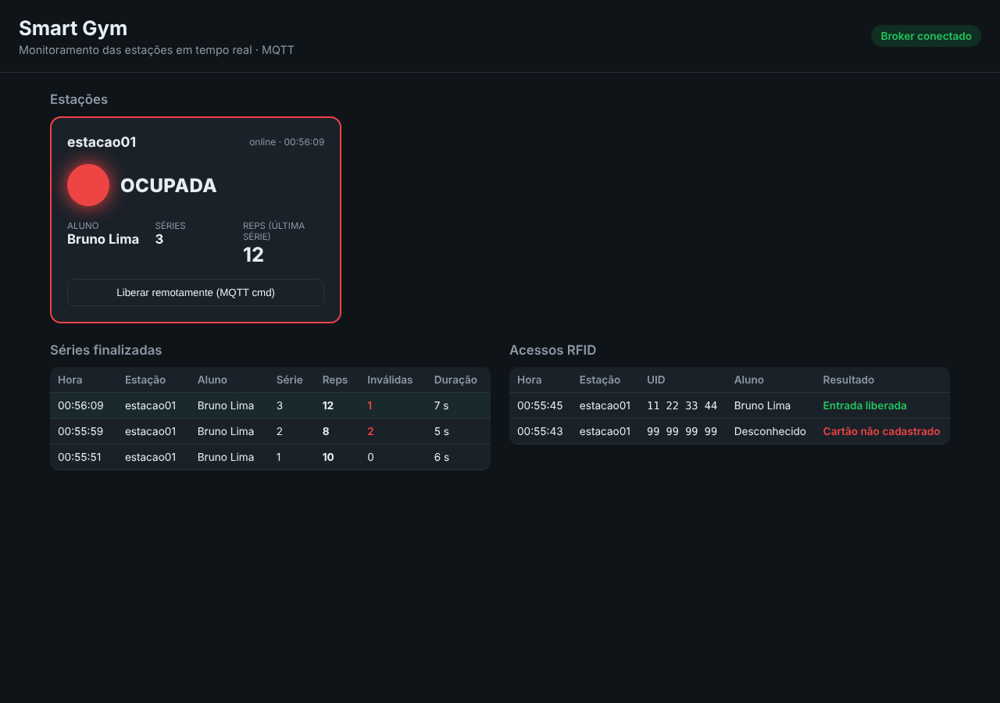
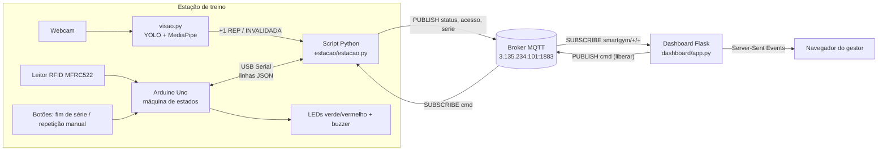
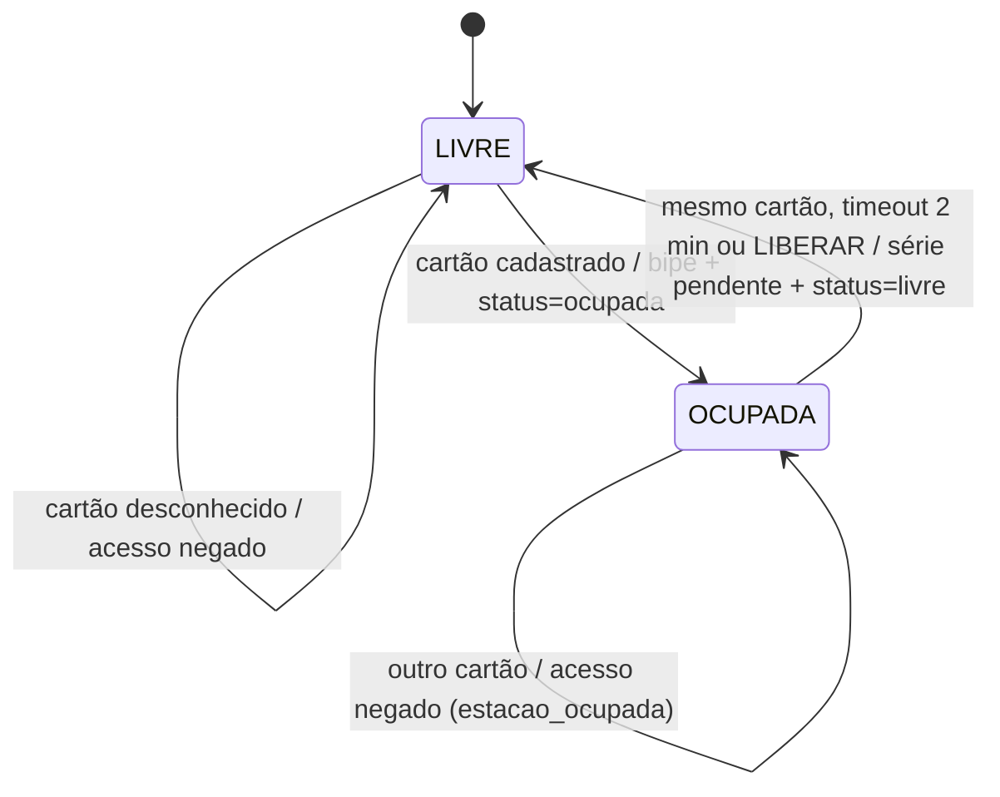
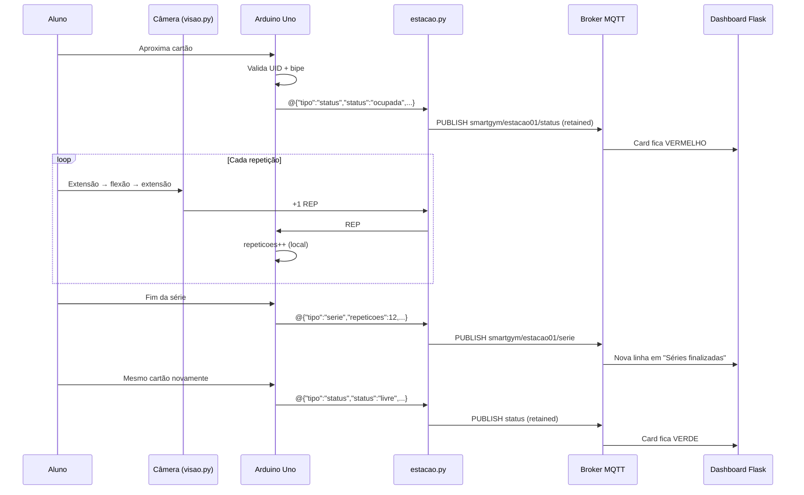

# Smart Gym – Checkpoint 05: Conectividade IoT e Telemetria em Nuvem

Estação de treino conectada com **controle de acesso por RFID** (Arduino Uno), **contagem de repetições por visão computacional** (YOLO + MediaPipe, evolução do CP04), **telemetria via MQTT (Publish/Subscribe)** feita por um **script Python** e um **dashboard web em Flask** que mostra em tempo real se a máquina está livre ou ocupada e o resultado de cada série.



---

## Sumário

1. [Equipe](#equipe)
2. [Visão geral](#visão-geral)
3. [Arquitetura](#arquitetura)
4. [Hardware e pinagem](#hardware-e-pinagem)
5. [Visão computacional (evolução do CP04)](#visão-computacional-evolução-do-cp04)
6. [Protocolo Serial (Uno ↔ Python)](#protocolo-serial-uno--python)
7. [Protocolo MQTT: tópicos e payloads](#protocolo-mqtt-tópicos-e-payloads)
8. [Máquina de estados e fluxo](#máquina-de-estados-e-fluxo)
9. [Como executar](#como-executar)
10. [Roteiro de demonstração](#roteiro-de-demonstração)
11. [Decisões técnicas](#decisões-técnicas)
12. [Limitações e próximos passos](#limitações-e-próximos-passos)
13. [Estrutura do repositório](#estrutura-do-repositório)

---

## Equipe

**Nome da equipe:** _Preencher_ · **Turma:** 3ESPZ

| Integrante | RM |
|---|---|
| Bruna da Costa Candeias | RM 558938 |
| Fernando Navajas Moraes | RM 555080 |
| Gabriel Terra Lilla dos Santos | RM 554575 |
| José Guilherme Sipaúba Costa | RM 557274 |
| Weslley Cardoso | RM 557927 |

---

## Visão geral

| Requisito do CP05 | Como foi atendido |
|---|---|
| Telemetria via MQTT (Publish) | O script Python da estação (`estacao/estacao.py`) é o **Publisher**: publica status, acessos e performance no broker. |
| Status de ocupação ativado pelo login/logout RFID | Passar o cartão cadastrado publica `ocupada`; passar o mesmo cartão de novo publica `livre`. |
| Performance ao final de cada série | As repetições são contadas pela câmera (ciclos completos de extensão → flexão → extensão) e, ao apertar "Fim da série", é publicado `{aluno, serie, repeticoes, invalidadas, duracao_s}`. **Só a série concluída vai para a rede.** |
| Dashboard Web (Flask) | `dashboard/app.py` é o **Subscriber**: atualiza o navegador em tempo real, **sem refresh manual**. Card **verde (LIVRE)** ou **vermelho (OCUPADA)**. |
| Histórico recente | Tabela "Séries finalizadas" (quem treinou e o resultado) e log de acessos RFID, atualizados automaticamente. |
| Orientado a eventos | `Ocupada` é publicado imediatamente após o bipe do RFID; nenhuma mensagem é enviada por repetição. |

Extras: *Last Will* (a estação aparece como **OFFLINE** se o script cair), *retained* no status (o dashboard abre já com o estado atual), liberação remota da máquina pelo dashboard (Subscribe no lado da estação) e timeout por inatividade.

---

## Arquitetura

O Arduino Uno não tem Wi-Fi. Por isso a responsabilidade é dividida em três camadas:



| Camada | Arquivo | Papel |
|---|---|---|
| Arduino Uno | `firmware/smart_gym_uno/smart_gym_uno.ino` | Lê o RFID, valida o aluno, controla LEDs/buzzer/botões e mantém o estado LIVRE/OCUPADA. Funciona mesmo sem rede. |
| Visão computacional | `estacao/visao.py` | Contador do CP04 (YOLO + MediaPipe) encapsulado na classe `ContadorVisao`. Detecta repetições válidas e invalidadas. |
| Script da estação | `estacao/estacao.py` | Ponte Serial ↔ MQTT. **Publisher** dos eventos, **Subscriber** do tópico de comando e envia `REP`/`INV` ao Uno a partir da câmera. |
| Dashboard | `dashboard/app.py` | **Subscriber** de todas as estações. Repassa os eventos ao navegador via SSE e guarda o histórico recente. |

---

## Hardware e pinagem

| Componente | Pino Arduino Uno | Observação |
|---|---|---|
| MFRC522 – SDA (SS) | D10 | SPI |
| MFRC522 – SCK | D13 | SPI |
| MFRC522 – MOSI | D11 | SPI |
| MFRC522 – MISO | D12 | SPI |
| MFRC522 – RST | D9 | |
| MFRC522 – 3.3V / GND | 3.3V / GND | **Não ligar em 5V** |
| Botão "Repetição" (manual) | D2 | `INPUT_PULLUP`, outro terminal no GND. Plano B se a câmera falhar |
| Botão "Fim da série" | D3 | `INPUT_PULLUP`, outro terminal no GND |
| LED verde (livre) | D5 | resistor 220 Ω |
| LED vermelho (ocupada) | D6 | resistor 220 Ω |
| Buzzer | D8 | |

>  `wokwi/diagram.json` contém o circuito de LEDs, botões e buzzer como referência visual de montagem. O Wokwi não possui o módulo MFRC522.

### Alunos cadastrados

| UID | Aluno |
|---|---|
| `E2 A3 5F 11` | Ana Souza |
| `EC B8 53 73` | Bruno Lima |

**Para cadastrar os cartões reais:** passe o cartão com o script rodando. O UID aparece no terminal como acesso negado (`nao_cadastrado`). Copie o UID para o vetor `ALUNOS[]` no firmware e grave de novo.

---

## Visão computacional (evolução do CP04)

O contador de repetições do CP04 foi reaproveitado como o "sensor" da estação. Com `--visao`, cada repetição detectada pela câmera vira um comando `REP` para o Uno, que continua sendo o dono da máquina de estados.

| Etapa | Como funciona |
|---|---|
| Equipamento | YOLO (classe COCO 67, *cell phone*) como substituto do halter, já que o COCO não possui essa classe. O equipamento precisa estar **na mão** (distância punho ↔ caixa) e passa por uma votação em janela de 10 frames contra *flicker*. |
| Ângulo do cotovelo | MediaPipe PoseLandmarker (ombro, cotovelo, punho) com suavização EMA e tolerância de 5 frames sem pose. |
| Repetição válida | Ciclo completo: extensão (≥ 150°) → flexão (≤ 50°) → extensão. Garante **amplitude de movimento** completa. |
| Repetição invalidada | O aluno estava flexionado e perdeu o equipamento ou a pose. Vira `INV` e é publicada em `invalidadas`. |
| Contexto na tela | Rodapé com o status da estação, o aluno identificado pelo RFID e o **tempo de descanso** desde a última série, comparado com a faixa ideal de 60–90 s. |

Regras da integração (em `estacao.py`):
- Repetições só contam com um aluno identificado pelo RFID; com a estação livre, os eventos da câmera são ignorados.
- O contador da câmera **zera a cada série** e a cada troca de aluno.

**Melhorias em relação ao CP04:**

| Problema no CP04 | Correção |
|---|---|
| Contador acumulava para sempre (zerava só com a tecla `r`) | `zerar()` chamado automaticamente no fim de cada série e na troca de aluno |
| ESQ/DIR invertidos com a imagem espelhada | Mapeamento `ARMS_ESPELHADO` quando o espelho está ativo |
| YOLO a cada frame, com FPS baixo na CPU | `--yolo-every N` (padrão 2), reaproveitando as caixas entre execuções |
| Repetições invalidadas só apareciam na tela | Enviadas ao Uno (`INV`) e publicadas no MQTT |
| Loop dentro de `main()`, não reutilizável | Classe `ContadorVisao` com *callbacks*; `python estacao/visao.py` continua rodando sozinho como no CP04 |

---

## Protocolo Serial (Uno ↔ Python)

9600 baud, uma mensagem por linha.

| Direção | Formato | Exemplo |
|---|---|---|
| Uno → PC (evento) | `@` + JSON | `@{"tipo":"status","status":"ocupada","aluno":"Ana Souza","serie":0,"motivo":"entrada"}` |
| Uno → PC (log) | texto livre | `Repeticao 3` |
| PC → Uno | `UID <uid>` | `UID E2 A3 5F 11` (simula um cartão) |
| PC → Uno | `REP` | repetição válida detectada pela câmera |
| PC → Uno | `INV` | repetição invalidada pela câmera |
| PC → Uno | `LIBERAR` | encerra a sessão (comando remoto) |
| PC → Uno | `STATUS` | reenvia o status atual |

O prefixo `@` separa eventos de mensagens de depuração: o script só publica linhas que começam com `@`, e as demais aparecem no terminal como `[UNO] ...`.

---

## Protocolo MQTT: tópicos e payloads

Padrão de tópico: `smartgym/<estacao>/<tipo>`. Todos os payloads são JSON, exceto `conexao` e `cmd`.

| Tópico | Quem publica | Retained | Quando | Exemplo de payload |
|---|---|---|---|---|
| `smartgym/estacao01/status` | estação | **sim** | login, logout, timeout, comando remoto | `{"status":"ocupada","aluno":"Ana Souza","serie":0,"motivo":"entrada","estacao":"estacao01"}` |
| `smartgym/estacao01/acesso` | estação | não | todo cartão lido | `{"uid":"99 99 99 99","aluno":"Desconhecido","autorizado":false,"motivo":"nao_cadastrado","estacao":"estacao01"}` |
| `smartgym/estacao01/serie` | estação | não | **fim de cada série** | `{"aluno":"Ana Souza","uid":"E2 A3 5F 11","serie":1,"repeticoes":12,"invalidadas":1,"duracao_s":34,"estacao":"estacao01"}` |
| `smartgym/estacao01/conexao` | estação / **LWT** | **sim** | `online` ao conectar; `offline` pelo broker se o script cair | `online` |
| `smartgym/estacao01/cmd` | dashboard | não | botão "Liberar remotamente" | `liberar` ou `status` |

Valores de `motivo` em `acesso`: `entrada`, `saida`, `nao_cadastrado`, `estacao_ocupada`.
Valores de `motivo` em `status`: `inicio`, `entrada`, `saida`, `timeout`, `remoto`, `consulta`.

---

## Máquina de estados e fluxo

A lógica da estação, no Uno, é uma máquina de dois estados (`ocupada = false/true`):



| Função no firmware | Responsabilidade |
|---|---|
| `tratarCartao()` | Decide a transição a partir do UID lido (com anti-repique de 2 s) |
| `iniciarSessao()` | LIVRE → OCUPADA: LEDs, bipe e evento de status |
| `finalizarSerie()` | Emite a performance da série e zera o contador |
| `encerrarSessao()` | OCUPADA → LIVRE, emitindo antes a série pendente |
| `registrarRepeticao()` | Conta repetições válidas/invalidadas (só com aluno identificado) |
| `processarComando()` | Trata `UID`, `REP`, `INV`, `LIBERAR` e `STATUS` recebidos pela Serial |

| Função no script Python | Responsabilidade |
|---|---|
| `executar()` | Lê a Serial e encaminha cada evento `@{...}` |
| `publicar_evento()` | Publica no tópico correto (status com retained) |
| `ao_conectar()` | Publica `online`, assina `cmd` e pede o status atual ao Uno |
| `ao_receber_comando()` | Traduz `liberar` (MQTT) em `LIBERAR` (Serial) |
| `ao_evento_visao()` | Traduz `+1 REP` / `REP INVALIDADA` da câmera em `REP` / `INV` |
| `atualizar_estado_local()` | Espelha o estado do Uno e zera o contador da câmera por série e por aluno |



---

## Como executar

### 0. Pré-requisitos

- Arduino IDE com a biblioteca **MFRC522** (by GithubCommunity), instalada pelo Library Manager.
- Python 3.10 a 3.13 (limite do MediaPipe) e uma webcam.

```bash
python -m venv .venv
source .venv/bin/activate          # Windows: .venv\Scripts\activate
pip install -r requirements-visao.txt   # estação com câmera (inclui o requirements.txt)
# ou só: pip install -r requirements.txt  (dashboard / estação sem câmera)
```

> **Antes da apresentação**, rode `python estacao/visao.py` uma vez com internet. Isso baixa os modelos `yolo11n.pt` e `pose_landmarker_full.task`, e evita depender da rede da sala.

### 1. Broker MQTT

O projeto usa o broker disponibilizado pelo professor: `3.135.234.101:1883`. Para conferir se ele está acessível:

```bash
mosquitto_sub -h 3.135.234.101 -p 1883 -t 'smartgym/#' -v
```

Para usar outro broker (Mosquitto local, HiveMQ etc.), passe `--broker` à estação e `MQTT_HOST` ao dashboard.

### 2. Arduino Uno

1. Monte o circuito conforme a [pinagem](#hardware-e-pinagem).
2. Abra `firmware/smart_gym_uno/smart_gym_uno.ino`, selecione a placa **Arduino Uno** e a porta, e faça o upload.
3. **Feche o Monitor Serial da IDE.** Só um programa pode usar a porta por vez, e o script Python precisa dela.

### 3. Script da estação (Publisher)

```bash
python estacao/estacao.py --porta COM9 --visao                    # Windows (veja a porta na IDE)
python estacao/estacao.py --porta /dev/ttyACM0 --visao            # Linux
python estacao/estacao.py --porta COM9 --visao --pose-model lite  # CPU fraca
python estacao/estacao.py --porta COM9                            # sem câmera: repetições pelo botão
```

Opções da estação: `--broker`, `--broker-porta`, `--estacao` (padrão `estacao01`) e `--base` (padrão `smartgym`). Com `--visao`, também são aceitas as opções do contador: `--source` (índice da webcam), `--pose-model`, `--yolo-every`, `--ext`, `--flex`, `--any-position` e `--no-mirror`.

Com o script rodando, digitar um UID no terminal (ex.: `E2 A3 5F 11`) simula a leitura de um cartão. Na janela da câmera: `q` sai, `r` zera o contador e `s` alterna o braço (auto/esq/dir).

### 4. Dashboard (Subscriber)

```bash
python dashboard/app.py                 # broker 3.135.234.101:1883
MQTT_HOST=localhost python dashboard/app.py
```

Acesse <http://localhost:5000>. Variáveis de ambiente: `MQTT_HOST`, `MQTT_PORT`, `MQTT_USER`, `MQTT_PASS`, `TOPICO_BASE` e `PORT`.

### 5. Simulador (sem hardware)

Publica os mesmos tópicos de uma estação real: um cartão negado, uma entrada, 3 séries (10, 8 e 12 repetições, com algumas invalidadas) e a saída. Serve para testar o dashboard e como plano B na apresentação.

```bash
python estacao/simulador.py                          # cria a "estacao02"
ESTACAO_ID=estacao01 python estacao/simulador.py
```

---

## Roteiro de demonstração

1. Subir o dashboard e a estação com `--visao`: o card aparece **verde / LIVRE** e o rodapé da câmera mostra "passe o cartão RFID".
2. Passar um cartão **não cadastrado**: LED vermelho pisca, buzzer grave e a linha "Cartão não cadastrado" aparece no dashboard.
3. Passar um cartão **cadastrado**: bipe, LED vermelho aceso e o card fica **vermelho / OCUPADA** com o nome do aluno.
4. Fazer roscas segurando o celular: cada ciclo completo aparece como `+1 REP` na câmera e `[UNO] Repeticao n` no terminal, e **nada é publicado**. Soltar o celular no meio da flexão gera uma repetição **invalidada**.
5. Apertar "Fim da série": nova linha em **Séries finalizadas** com nome, série, repetições e inválidas. O rodapé da câmera passa a contar o descanso (ideal 60–90 s).
6. Passar **outro** cartão cadastrado: acesso negado (`Estação ocupada`).
7. Passar o primeiro cartão de novo: o card volta para **verde / LIVRE**.
8. *(Bônus: Subscribe na estação)* Com a máquina ocupada, clicar em **Liberar remotamente**. O comando percorre dashboard → broker → Python → Serial → Uno, e o LED verde acende.
9. *(Bônus: LWT)* Encerrar o script da estação: em alguns segundos o card fica cinza (**OFFLINE**).

---

## Decisões técnicas

| Decisão | Motivo |
|---|---|
| **Estado no Uno, rede no Python** | O feedback físico (LED/bipe) é imediato e não depende da rede; o Python cuida só da conectividade. Se o broker cair, a estação continua funcionando. |
| **JSON com prefixo `@` na Serial** | O Python encaminha o evento quase sem transformação e logs de depuração não poluem o MQTT. No Uno, os formatos ficam na flash (`PSTR`) para economizar os 2 KB de RAM. |
| **Câmera como "sensor", Uno como dono do estado** | A visão só envia `REP`/`INV`; quem decide se a repetição conta é a máquina de estados do Uno. Se a câmera falhar, o botão manual mantém a estação funcionando. |
| **Repetições não são publicadas** | Seguindo a orientação do desafio, a performance só é enviada ao término da série: 12 repetições geram 1 mensagem em vez de 12. |
| **`status` e `conexao` com retained** | Um cliente que conecta depois (dashboard recarregado) recebe imediatamente o último estado. |
| **Last Will and Testament** | Detecta a queda da estação sem *polling*: o broker avisa sozinho quando o keep-alive (15 s) expira. |
| **Eventos sem retained** (`acesso`, `serie`) | São fatos pontuais; retê-los faria um dashboard novo "reviver" uma série antiga. |
| **Hierarquia `smartgym/<estacao>/<tipo>`** | Escala para várias máquinas com um único wildcard (`smartgym/+/+`). Basta rodar outro script com `--estacao estacao02`. |
| **Flask + SSE** | O Flask assina o broker (paho-mqtt) e empurra cada evento ao navegador por Server-Sent Events: atualização sem refresh e sem depender de porta WebSocket no broker. |

---

## Limitações e próximos passos

- **Segurança:** broker sem TLS e sem autenticação (ambiente acadêmico). Em produção: porta 8883 com TLS, credencial por estação e ACL restringindo cada uma aos próprios tópicos.
- **Cadastro de alunos fixo no firmware:** o próximo passo é validar o UID no script Python ou na nuvem, para cadastrar alunos sem regravar o Arduino.
- **Histórico em memória:** o dashboard guarda as últimas 50 séries; reiniciá-lo apaga o histórico. Próximo passo: persistir em banco (SQLite).
- **Dependência do computador:** a estação precisa de um PC (USB + câmera). Para o RFID e o MQTT, uma evolução natural é o ESP32, que publica direto via Wi-Fi.
- **Equipamento por proxy:** o YOLO detecta um celular no lugar do halter. Próximo passo: treinar um modelo com imagens de halteres.
- **Fim da série manual:** poderia ser automático após alguns segundos sem repetições.

---

## Estrutura do repositório

```
smart-gym-cp5/
├── README.md
├── requirements.txt                 # flask, paho-mqtt, pyserial
├── requirements-visao.txt           # + ultralytics, opencv-python, mediapipe
├── firmware/
│   └── smart_gym_uno/
│       └── smart_gym_uno.ino        # Arduino Uno: RFID, LEDs, botões, máquina de estados
├── estacao/
│   ├── estacao.py                   # Publisher: Serial (Uno) -> MQTT; assina cmd; integra a câmera
│   ├── visao.py                     # contador YOLO + MediaPipe (evolução do CP04)
│   └── simulador.py                 # estação virtual para testes sem hardware
├── dashboard/
│   ├── app.py                       # Flask: Subscriber MQTT -> SSE + API de comandos
│   ├── templates/index.html
│   └── static/                      # CSS e JS do front-end
├── wokwi/
│   ├── diagram.json                 # referência visual do circuito (sem o MFRC522)
│   └── libraries.txt
└── docs/
    └── dashboard.png
```
